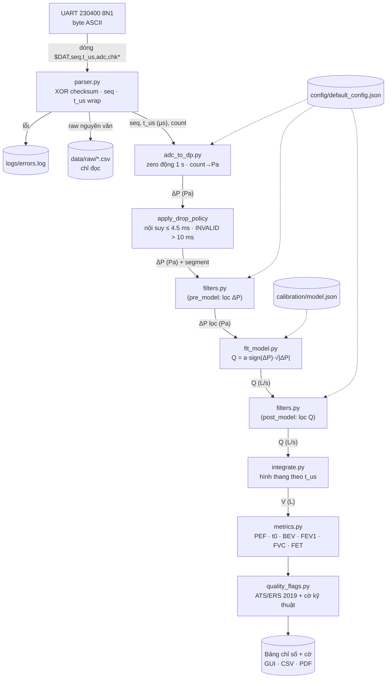

# Kiến trúc pipeline xử lý tín hiệu — Smart Spirometer (VIE-01)

Người thực hiện: Nguyễn Hoàng Việt · Phiên bản: v1.0 · Ngày: 05/11/2026

Pipeline là **một chiều**: dữ liệu đi từ byte UART thô tới bảng chỉ số và cờ chất lượng, không khâu nào
ghi ngược lên dữ liệu phía trước. File raw được lưu nguyên văn và chỉ đọc; mọi kết quả đều tái lập được
từ file raw + `config/default_config.json` + `calibration/model.json`.

## 1. Sơ đồ luồng dữ liệu

Chỉ một trong hai khối lọc được bật, theo `filter_placement` (`pre_model` mặc định). Hình tĩnh của sơ đồ:
`docs/pipeline_architecture.svg`.

## 2. Định dạng và đơn vị tại từng khâu

| # | Khâu | Đại lượng | Kiểu dữ liệu | Đơn vị | Công thức / ghi chú |
|---|---|---|---|---|---|
| 0 | UART | dòng ASCII | `bytes` | — | `$DAT,<seq>,<t_us>,<adc_raw>,<chk>*\r\n` |
| 1 | Parser | seq | uint16 (quay vòng 65536) | — | mất gói khi Δseq > 1 |
| 1 | Parser | t_us | uint32 → int64 sau unwrap | µs | tràn sau 2³² µs ≈ 71.58 phút → cộng 2³² |
| 1 | Parser | count | int (0–4095) | count | 0 hoặc 4095 → `ADC_SATURATED` |
| 2 | ADC | Vadc | float64 | V | Vadc = count × Vref / 4095 |
| 3 | Phân áp | Vout | float64 | V | Vout = Vadc / k (k = 2/3 danh định) |
| 4 | Cảm biến | ΔP | float64 | Pa | P = 1000 × (Vout/Vs − 0.5) / 0.2 ; có zero động: P = (count − zero_adc) × 1.209 Pa/count |
| 5 | Mô hình | Q | float64 | L/s | Q = a · sign(ΔP) · √\|ΔP\| (a từ `model.json`) |
| 6 | Tích phân | V | float64 | L | V[n] = V[n−1] + ½(Q[n] + Q[n−1])(t[n] − t[n−1]) |
| 7 | Chỉ số | PEF / FEV1, FVC / FET | float64 | L/s / L / s | t0 ngoại suy ngược theo ATS/ERS 2019 |
| 8 | Cờ | flags, status | list[str], enum | — | PASSED / FAILED / INVALID |

Ví dụ kiểm tra số học (count = 2234, Vref = 3.3 V, k = 2/3, Vs = 5.0 V):
Vadc = 7372.2 / 4095 = 1.800293 V → Vout = 2.700440 V → ΔP = **200.44 Pa**.
Count tĩnh lý thuyết khi ΔP = 0 là **≈ 2068** (Vout = 2.5 V → Vadc = 1.667 V), không phải 2048.

## 3. Lọc trước hay sau mô hình căn thức

Mô hình Q = a√ΔP là **phi tuyến**, nên thứ tự "lọc rồi khai căn" và "khai căn rồi lọc" cho kết quả khác nhau.

| Tiêu chí | Lọc ΔP (pre_model) | Lọc Q (post_model) |
|---|---|---|
| Nhiễu đi vào | Nhiễu cộng Gauss trên ΔP (≈ 1.7 Pa), lọc đúng chỗ nhiễu sinh ra | Nhiễu đã bị √ biến dạng: khuếch đại mạnh quanh ΔP ≈ 0 (đạo hàm √x → ∞) |
| Độ lệch hệ thống | Trung bình nhiễu ≈ 0 được giữ, √ áp lên tín hiệu đã sạch | E[√(x+n)] ≠ √x: nhiễu quanh 0 bị chỉnh lưu thành Q dương giả, rồi tích phân thành thể tích giả |
| Dòng thấp / cuối nhịp | Ổn định hơn, ngưỡng deadband áp trên ΔP (1 Pa) | Nhạy với deadband, FVC lệch nhiều hơn |
| Kết quả mô phỏng (20 phiên KB1, Butterworth offline) | Sai số FVC −2.41 % | Sai số FVC −4.16 % |

Kết luận: chọn `filter_placement = "pre_model"`. Bộ lọc hiển thị Live phải nhân quả (MA N = 5, trễ 4 ms);
xử lý Offline sau khi bấm Dừng dùng Butterworth bậc 2, fc = 15 Hz, `filtfilt` (pha 0). Savitzky–Golay bị
cấm trong Live vì cần mẫu tương lai (mã ném `NonCausalInLiveModeError`).

## 4. Cấu hình (`config/config_schema.json`)

Mọi tham số phần cứng đọc từ config; không hardcode trong mã. Schema dùng JSON Schema draft-07,
`additionalProperties: false` (gõ sai tên trường bị từ chối).

| Trường | Kiểu | Bắt buộc | Giá trị mặc định | Người cung cấp |
|---|---|---|---|---|
| sample_rate_hz | integer (500) | ✔ | 500 | Quang |
| adc_bits | integer (12) | ✔ | 12 | Quang |
| adc_divisor | 4095 \| 4096 | ✔ | 4095 | Nhóm |
| vref_v | number 3.0–3.6 | ✔ | 3.3 | Nhung |
| divider_ratio | number (0, 1] | ✔ | 0.666667 | Nhung |
| divider_ratio_measured | number \| null |  | null (chờ đo) | **Nhung** |
| vs_nominal_v | number (5.0) | ✔ | 5.0 | Nhung |
| vs_measured_v | number 4.5–5.5 \| null |  | null (chờ đo) | **Nhung** |
| sensor_model | string |  | cần xác nhận | **Nhung / Trí** |
| sensor_offset_frac | number | ✔ | 0.5 | datasheet |
| sensor_sens_per_kpa | number > 0 | ✔ | 0.2 | datasheet |
| zero_adc | integer 1900–2200 | ✔ | 2068 (chỉ dự phòng; luôn đo zero động) | Việt |
| zero_samples, zero_max_std_count | integer, number |  | 500, 5.0 | Việt |
| filter_placement | pre_model \| post_model | ✔ | pre_model | Việt |
| filter_live, filter_offline, ma_window, butter_*, savgol_* | enum / số |  | MA 5 / Butterworth 2, 15 Hz | Việt |
| dp_deadband_pa, interp_max_gap_s, invalid_gap_s | number |  | 1.0 Pa, 4.5 ms, 10 ms | Việt |
| hardware_version | hw_v1.0 \| hw_v1.1 | ✔ | hw_v1.0 | Nhung |
| firmware_version | fw_v1.0 | ✔ | fw_v1.0 | Quang |
| airpath_version | airpath_v1.0 \| airpath_v2.0 | ✔ | airpath_v1.0 | Trí |
| calibration_id | string \| null |  | null | Việt (sau VIE-14) |
| model_path | string |  | calibration/model.json | Việt |
| simulation | boolean | ✔ | true | — |

Kiểm chứng: `python -m pytest tests/test_config.py -v` — config mặc định hợp lệ; thiếu `vs_nominal_v`,
`sample_rate_hz` sai kiểu chuỗi, `filter_placement` sai giá trị đều ném `jsonschema.ValidationError`.

## 5. Điểm còn mở

1. **Mã cảm biến.** Sổ tay ghi MPX5010DP nhưng dùng hàm truyền 0.2·P + 0.5 (của MPXV7002DP, ±2 kPa).
   MPX5010DP có hàm truyền Vout = Vs·(0.09·P + 0.04), dải 0–10 kPa. Cần Nhung/Trí xác nhận linh kiện
   thực tế; nếu là MPX5010DP thì đổi `sensor_offset_frac = 0.04`, `sensor_sens_per_kpa = 0.09` và
   khoảng `zero_adc`.
2. Nhung đo và điền `divider_ratio_measured`, `vs_measured_v`.
3. Quang xác nhận cách tính checksum (ví dụ trong sổ tay ghi `74`, XOR thực của
   `DAT,105,210000,2234` là `4D`).

## 6. Phê duyệt schema

| Thành viên | Vai trò | Ký | Ngày |
|---|---|---|---|
| Nguyễn Hoàng Việt | Software & Signal Processing |  |  |
| Quang | Firmware UART |  |  |
| Nhung | Phần cứng & cầu phân áp |  |  |
| Nguyễn Gia Trí | Đường khí & cảm biến, trưởng dự án |  |  |
