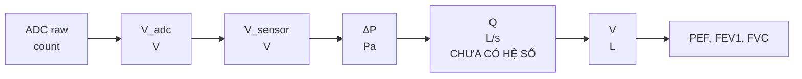

# Yêu cầu phần mềm và chuỗi tính toán – Smart Spirometer

| Mục | Nội dung |
| --- | --- |
| Gói việc | VIET-01 – Chốt chuỗi tính toán và giao thức |
| Phiên bản | v1 (bản bàn giao Tuần 1) |
| Người viết | Việt |
| Người kiểm tra | Quang |
| Nhận tham chiếu | Trí (yêu cầu UI); Nhung (thông số analog cần biết) |
| Trạng thái | Chờ kiểm tra. Chỉ đánh dấu Xong sau khi được duyệt |

> **Phạm vi:** đây là mô hình học thuật, không phải thiết bị chẩn đoán đã kiểm định.
> Tài liệu này mô tả phần việc Python: từ mã ADC thô đến các chỉ số hô hấp.

---

## 1. Chuỗi tính toán

**Nguyên tắc bắt buộc:** trước khi có `calibration/model.json` hợp lệ (Tuần 5), mọi tín hiệu chỉ được hiển thị tối đa ở mức **ΔP (Pa)**. Không đổi ADC hoặc ΔP thành L/s bằng hệ số chưa hiệu chuẩn.

## 2. Bảng công thức, hệ số và trạng thái

| Khối | Công thức | Hệ số | Nguồn | Trạng thái |
| --- | --- | --- | --- | --- |
| ADC → V_adc | `V_adc = adc × Vref / 2^N` | N (số bit), Vref | Quang, Nhung; datasheet STM32G030 | **CẦN XÁC MINH**: N, Vref thực tế, có oversampling hay không |
| V_adc → V_sensor | `V_s = V_adc × (R1 + R2) / R2` | R1, R2 | Nhung | Tham khảo 10 kΩ / 20 kΩ (hệ số ×1,5). **Chưa duyệt**; cần xác nhận R1 nằm phía trên hay dưới |
| V_sensor → ΔP | `ΔP [Pa] = (V_s − V_zero) / S` | S = 1,0 V/kPa (typ) = 0,001 V/Pa; V_zero danh định = Vs × 0,5 = 2,5 V (khi Vs = 5,0 V) | NXP MPXV7002 Rev. 5 (05/05/2021): Table 5 (tr. 4) cho S, Voff; Fig. 7 (tr. 6) cho công thức `Vout = Vs × (0,2 × P[kPa] + 0,5)` | S và công thức: **đã đối chiếu datasheet**. V_zero thực tế **đo bằng lệnh Zero**, không hardcode. Vs thực tế: CHỜ XỬ LÝ (Nhung) |
| ΔP → Q | `Q = f(ΔP)` | chưa có | Hiệu chuẩn, Tuần 5 | **CHƯA CÓ HỆ SỐ** |
| Q → V | `V = ∫Q dt` (quy tắc hình thang, dùng timestamp thực của từng mẫu) | không | Việt (software) | Làm ở Tuần 3 |
| Q(t), V(t) → chỉ số | PEF, FEV1, FVC theo quy tắc mốc | quy tắc do Việt viết ra | Việt (software) | Tuần 3. Quy tắc mốc bắt đầu/kết thúc **CHƯA CHỐT** |

**Lưu ý về điện áp cảm biến:** datasheet (Table 5, chú thích [3]) định nghĩa Voff là điện áp ra **tại áp suất định mức nhỏ nhất (−2 kPa)**, giá trị typ 0,5 V (min 0,25 V, max 0,75 V). Vì vậy 0,5 V **không** phải điểm ΔP = 0. Tại ΔP = 0, công thức datasheet cho Vout = 5,0 × 0,5 = 2,5 V (danh định). Nếu dùng nhầm 0,5 V làm V_zero thì khi không có dòng khí công thức sẽ báo ΔP ≈ +2 kPa.

**Lưu ý về đơn vị S:** ghi rõ V/kPa hay V/Pa trong code và tài liệu. Lẫn kPa với Pa gây sai số 1000 lần.

**Lưu ý về nguồn:** cảm biến đo theo tỉ lệ với nguồn 5 V còn ADC tham chiếu theo Vref 3,3 V. Nếu hai nguồn trôi khác nhau thì zero trôi. Cần Nhung xác nhận độ ổn định nguồn (xem mục Chờ xử lý).

## 2b. Thông số cảm biến theo datasheet (MPXV7002DP)

Nguồn: NXP MPXV7002, Rev. 5, 05/05/2021. Điều kiện chung: Vs = 5,0 V, TA = 25 °C (trừ khi ghi khác).

| Thông số | Giá trị datasheet | Vị trí | Ảnh hưởng tới phần mềm |
| --- | --- | --- | --- |
| Dải áp suất | −2,0 đến +2,0 kPa | Table 5, tr. 4 | Ngoài dải thì **đầu ra bão hòa** (tr. 5): đánh cờ clipping, không tin số liệu |
| Điện áp nguồn | 4,75 / 5,0 / 5,25 V; đầu ra **theo tỉ lệ (ratiometric)** với Vs | Table 5, tr. 4 | Vs lệch làm V_zero và S lệch theo; đo Vs thực |
| Độ nhạy | 1,0 V/kPa (typ) | Table 5, tr. 4 | S = 0,001 V/Pa |
| Offset Voff (tại −2 kPa) | 0,25 / 0,5 / 0,75 V (min/typ/max), 10–60 °C | Table 5, tr. 4 | Zero thực có thể lệch khoảng ±0,25 V so với danh định (suy ra, tự kiểm tra) → **bắt buộc Zero mỗi phiên** |
| Điện áp ra toàn thang VFSO | 4,25 / 4,5 / 4,75 V | Table 5, tr. 4 | |
| Dải đầu ra toàn thang VFSS | 3,5 / 4,0 / 4,5 V | Table 5, tr. 4 | Span cũng có dung sai |
| Độ chính xác | ±2,5 % VFSS (typ), ±6,25 % VFSS (max); giả định **đã auto-zero** và nhiệt độ lệch tối đa ±5 °C giữa lúc zero và lúc đo | Table 5 và chú thích [6], [7], tr. 4 | Xem mục sai số cảm biến trong `evaluation_plan.md` |
| Thời gian đáp ứng (10–90 %) | 1,0 ms (typ) | Table 5, chú thích [8], tr. 4 | Cộng vào ngân sách trễ |
| Thời gian khởi động | 20 ms | Table 5, chú thích [9], tr. 4 | Không lấy Zero/đo ngay sau khi cấp nguồn |
| Dòng ra nguồn tại toàn thang | 0,1 mA (typ) | Table 5, tr. 4 | Xem cảnh báo tải chia áp bên dưới |
| Nhiệt độ hoạt động | 10 đến 60 °C | Table 4, tr. 3 | Ngoài dải thì bù nhiệt không đảm bảo |
| Áp suất tối đa | 75 kPa (P1 > P2) | Table 4, tr. 3 | Giới hạn an toàn cơ học |
| Môi chất | Đặc tính dựa trên **không khí khô**; môi chất khác có thể ảnh hưởng xấu tới hiệu năng và độ bền | mục 9.1, tr. 5 | Hơi thở ẩm: cần chống ẩm/đọng nước (báo Trí, Nhung) |
| Mạch lọc nguồn | Hình 6 (1,0 µF, 0,01 µF, 470 pF) **bắt buộc để đạt thông số** | Fig. 6, tr. 5 | Hỏi Nhung đã có trên mạch chưa |

**Cảnh báo cần hỏi Nhung (CẦN XÁC MINH):** chia áp 10 kΩ + 20 kΩ = 30 kΩ tại điện áp ra 4,5 V kéo khoảng 4,5 / 30 kΩ = 0,15 mA, lớn hơn dòng ra typ 0,1 mA tại toàn thang theo datasheet. Cần Nhung đánh giá xem có ảnh hưởng độ chính xác gần đầu thang không (ví dụ dùng điện trở lớn hơn hoặc đệm), đồng thời cân nhắc thời gian lấy mẫu ADC khi trở nguồn lớn.

**Quy ước cổng áp:** datasheet xác định cổng P1 (bên có dấu part marking đối với MPXV7002DP, Table 6, tr. 6) và P2. Áp suất tối đa nêu cho P1 > P2. Quy ước ΔP = P1 − P2 là **suy ra** từ datasheet, chưa phải câu chữ chính thức; kiểm chứng bằng thử bàn (REQ-12).

## 3. Định nghĩa đại lượng và đơn vị

| Đại lượng | Ký hiệu | Đơn vị | Có hệ số chưa? | Ghi chú |
| --- | --- | --- | --- | --- |
| Mã ADC | `adc` | count | Có | Số nguyên, chưa quy đổi |
| Điện áp tại ADC | `V_adc` | V | Cần Vref, N | |
| Điện áp tại cảm biến | `V_s` | V | Cần R1, R2 | |
| Chênh áp | `ΔP` | Pa | Cần S, V_zero | kPa chỉ dùng khi đọc datasheet |
| Lưu lượng | `Q` | L/s | **Chưa** | Chỉ có sau hiệu chuẩn |
| Thể tích | `V` | L | **Chưa** (phụ thuộc Q) | |
| Thời gian | `t` | s | Có | Lưu dạng µs trong dữ liệu thô |

**Quy ước (đề xuất, CẦN XÁC MINH):** ΔP = P1 − P2 theo định nghĩa cổng của datasheet (xem mục 2b). Dấu ΔP khi **thổi ra** hay **hút vào** phụ thuộc cách nối hai điểm lấy áp vào P1/P2. Hỏi Trí và Nhung. Kiểm chứng thực tế ở Tuần 4 (REQ-12).

## 4. Yêu cầu giao diện và phần mềm

| ID | Yêu cầu | Cách kiểm tra | Giai đoạn |
| --- | --- | --- | --- |
| REQ-01 | Chọn cổng COM và baudrate | Thủ công | Tuần 2–4 |
| REQ-02 | Nút Thu/Dừng. Ghi dữ liệu thô xuống file **trước** khi xử lý; không bao giờ ghi đè file raw | File raw tồn tại; chạy lại không đổi nội dung | Tuần 2–4 |
| REQ-03 | Nút Zero: lấy trung bình N mẫu khi không có dòng khí; hiển thị V_zero và độ lệch chuẩn σ | So với tính tay trên cùng dữ liệu | Tuần 2–4 |
| REQ-04 | Đồ thị theo thời gian. Trước hiệu chuẩn chỉ hiển thị ADC, V hoặc ΔP | Thủ công | Tuần 2 |
| REQ-05 | Hiển thị nhãn **CHƯA HIỆU CHUẨN** khi không có `model.json` hợp lệ; không hiển thị L/s | Test tự động | Tuần 4 |
| REQ-06 | Sau hiệu chuẩn: đồ thị Q(t), V(t); hiển thị PEF/FEV1/FVC kèm dải hiệu lực của model | Thủ công + test | Tuần 5–6 |
| REQ-07 | Cờ chất lượng: mất mẫu, clipping, kết thúc sớm | Test với dữ liệu tổng hợp | Tuần 2–5 |
| REQ-08 | Mở lại file raw và replay, hiển thị nhãn **REPLAY**; replay và live cho cùng kết quả | So sánh số liệu | Tuần 4 |
| REQ-09 | Thu nhận mẫu tách khỏi vẽ đồ thị (thread riêng, queue) để UI không làm mất mẫu | Thử tải; đếm seq | Tuần 4 |
| REQ-10 | Cảnh báo khi seq nhảy (mất mẫu), CRC sai hoặc timestamp không tăng; đoạn thiếu **không** được nối thành một lần đo hoàn chỉnh | Test với ca mất mẫu | Tuần 2, 4 |
| REQ-11 | Sau lệnh Zero hiển thị σ (LSB và Pa) để biết nhiễu nền | So với phép thử nhiễu tại zero | Tuần 4 |
| REQ-12 | Kiểm tra chiều ΔP: thổi vào và hút ra phải cho dấu đúng theo quy ước đã chốt | Thử bàn với Nhung | Tuần 4 |
| REQ-13 | Cảnh báo khi tín hiệu tiến sát hoặc vượt dải ±2 kPa của cảm biến | Test dữ liệu tổng hợp | Tuần 2–4 |

## 5. Tiêu chí chưa chốt

| Hạng mục | Tình trạng |
| --- | --- |
| Ngưỡng clipping (số mã ADC tính là chạm trần/đáy) | **CHƯA CHỐT** |
| Điều kiện "kết thúc sớm" (Q dưới ngưỡng trong bao lâu) | **CHƯA CHỐT** |
| Quy tắc mốc bắt đầu (cho FEV1) và kết thúc hợp lệ (cho FVC) | **CHƯA CHỐT** (Tuần 3) |
| Dấu ΔP | **CHƯA CHỐT** |
| Băng tần tín hiệu lưu lượng thở | **CẦN XÁC MINH** từ nguồn hô hấp hoặc phổ dữ liệu thật |

## 6. Chờ xử lý

| # | Cần ai | Câu hỏi | Trạng thái |
| --- | --- | --- | --- |
| 1 | Quang | N (12 hay 16 bit), có oversampling không, Vref thực | CHỜ XỬ LÝ |
| 2 | Nhung | R1, R2 chính xác; R1 nằm trên hay dưới | CHỜ XỬ LÝ |
| 3 | Nhung | Vref thực tế và độ ổn định nguồn 5 V / 3,3 V | CHỜ XỬ LÝ |
| 4 | Trí, Nhung | Dấu ΔP theo cách nối cổng cảm biến | CHỜ XỬ LÝ |
| 5 | Việt | Đối chiếu S và công thức với datasheet MPXV7002DP | ĐÃ ĐỐI CHIẾU (Rev. 5; xem mục 2b). Việt tự kiểm lại lần cuối |
| 6 | Nhung | Mạch lọc nguồn/đầu ra theo Fig. 6 datasheet đã có chưa | CHỜ XỬ LÝ |
| 7 | Nhung | Tải chia áp 30 kΩ so với dòng ra 0,1 mA (typ) của cảm biến | CHỜ XỬ LÝ |
| 8 | Trí, Nhung | Biện pháp chống ẩm cho cảm biến (datasheet dựa trên không khí khô) | CHỜ XỬ LÝ |

## 7. Bàn giao

- Trí nhận bản yêu cầu tham chiếu (mục 4).
- Nhung nhận danh sách thông số cần biết (mục 6, dòng 2–4).
- Quang nhận để đối chiếu với `shared/data_schema.md` và kiểm tra theo tiêu chí.